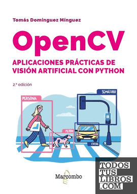
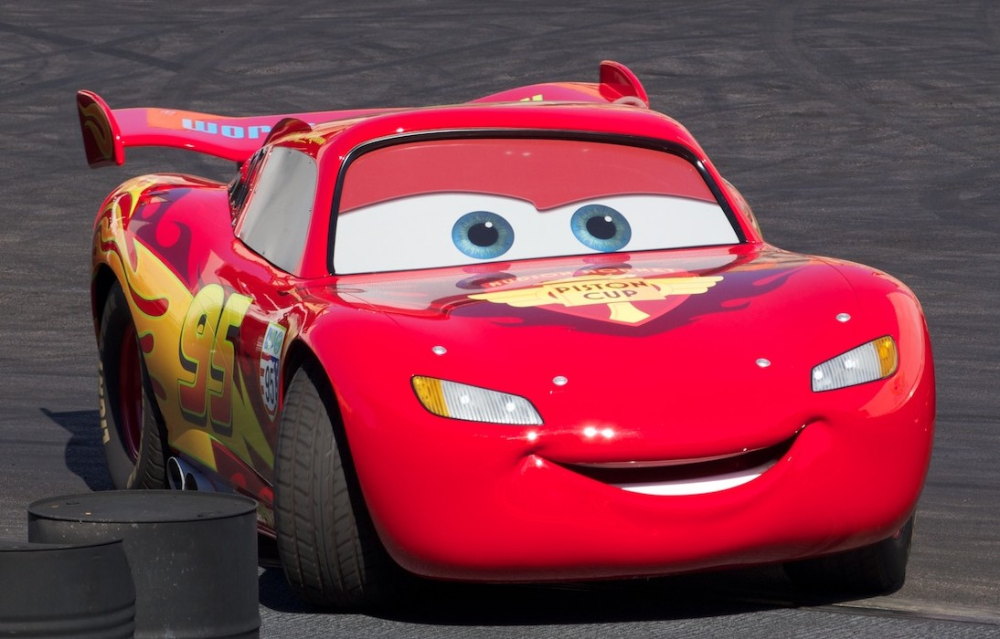
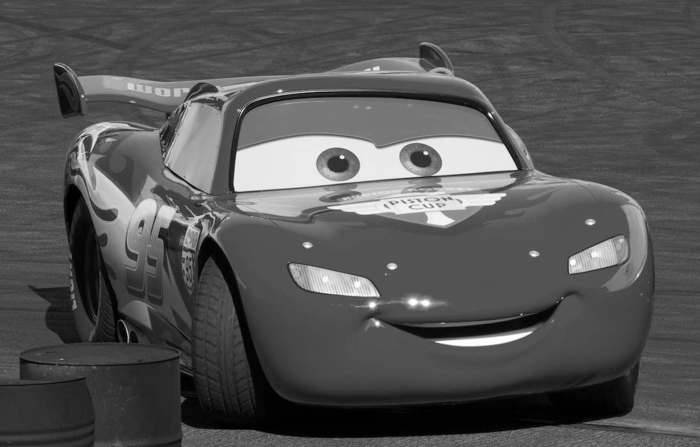
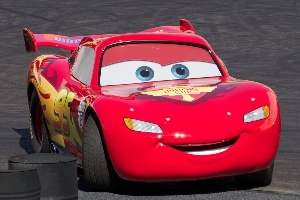
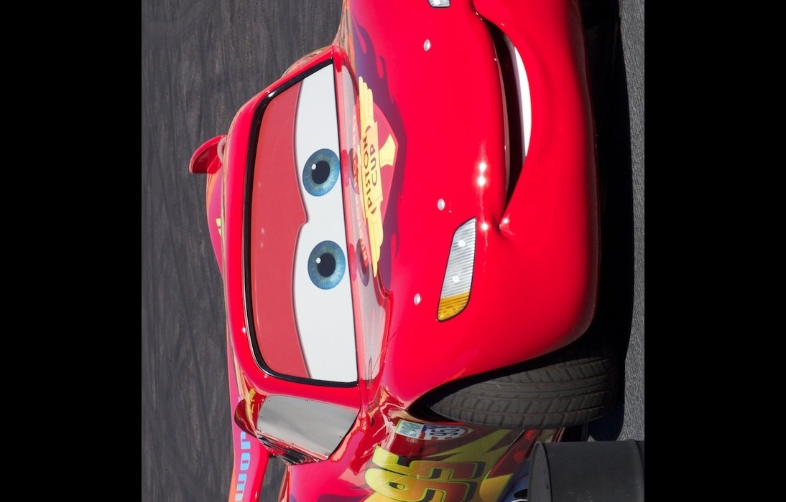
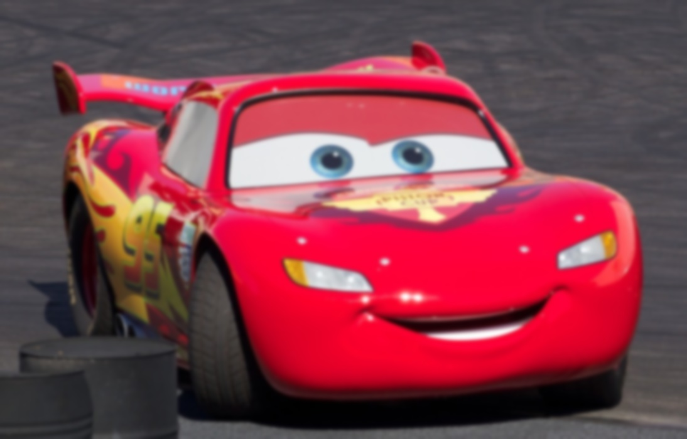
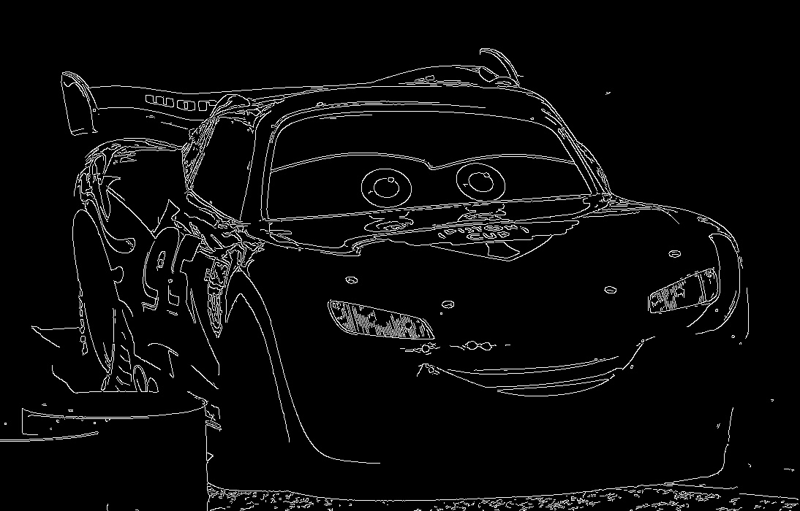
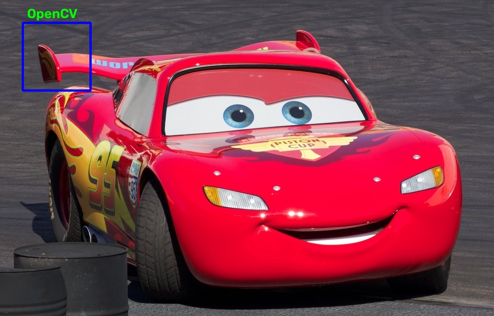
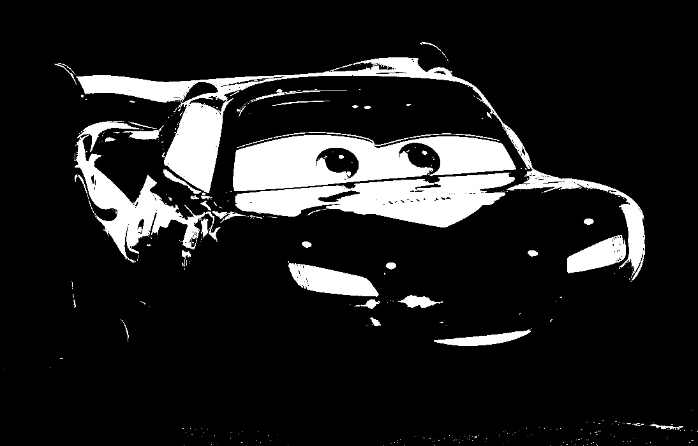
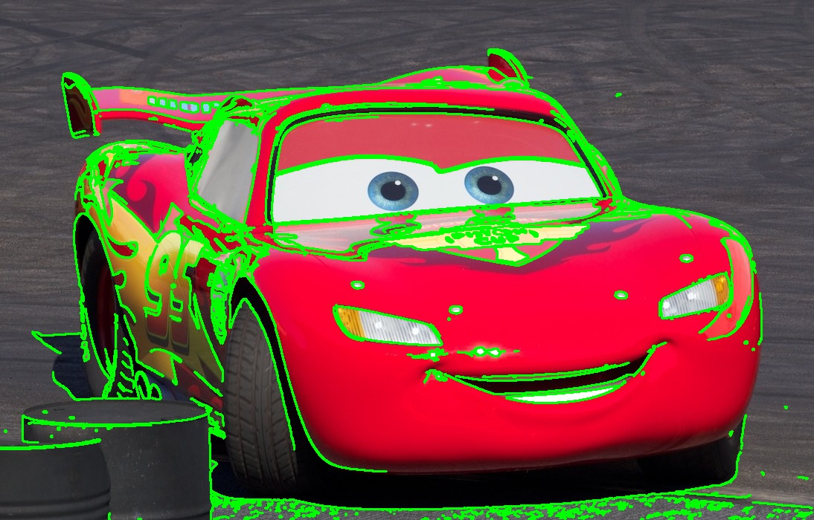

## Practica alumno con open cv
## Alumno Jaquez Andres NC 0074

## 2. Lectura y visualización de imágenes

## 3. Conversión entre espacios de color

## 4. Cambiar el tamaño de una imagen

## 5. Rotación de una imagen

## 6. Desenfocar una imagen

## 7. Detección de bordes mediante el algoritmo de Canny

## 8. Dibujar formas y añadir texto

## 9. Umbralización

## 10. Detección de contornos
